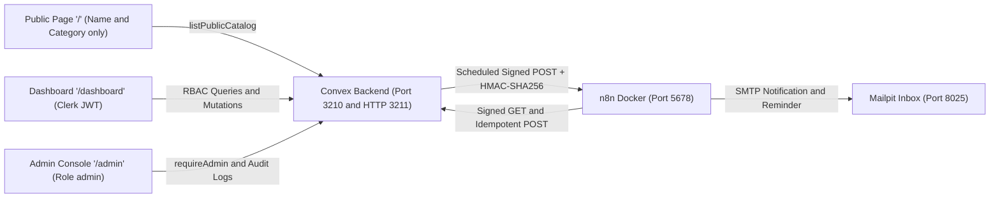
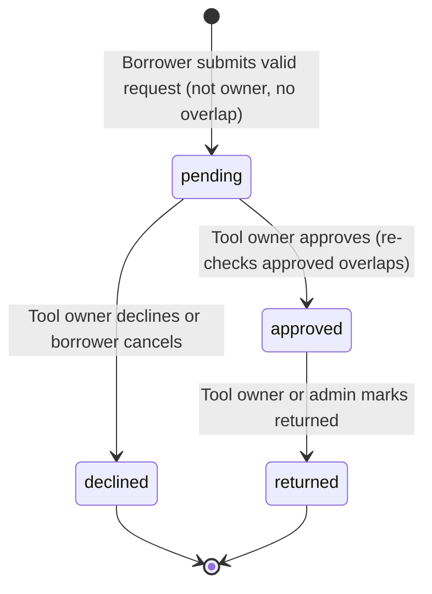

# LendLoop — Neighborhood Tool-Lending Board

> **“Borrow what you need. Lend what you don’t.”**

LendLoop is a neighborhood tool-lending board where neighbors list tools, request borrow date ranges, approve/return loans, and receive automated notifications and daily overdue reminders powered by **Next.js (App Router)**, **Clerk**, **Convex**, **self-hosted n8n (Docker)**, and **Mailpit**.

---

## Architecture Overview



### Loan State Machine



### Key Routes, Tables & Endpoints
- **App Routes**:
  - `/` ([src/app/page.tsx](src/app/page.tsx)): Public landing page showing **LendLoop**, tagline, `"Sign in to lend or borrow"`, and read-only available tools (`name` and `category` only).
  - `/dashboard` ([src/app/dashboard/page.tsx](src/app/dashboard/page.tsx)): Authenticated workspace with category filter (`All`, `Power Tools`, `Garden`, `Kitchen`, `Camping`, `Automotive`, `Cleaning`, `Other`), availability badges, `"Trusted Lender"` badges, **My Listings**, **My Requests**, **Incoming Requests**, and bonus automation activity chips (`"Reminder sent 2 days ago"`).
  - `/admin` ([src/app/admin/page.tsx](src/app/admin/page.tsx)): Dedicated Admin Console for viewing all loans, removing any listing, toggling `"Trusted Lender"`, seeding demo data in dev, and inspecting `automationEvents` + `securityAuditLogs`.
- **Convex Tables** ([convex/schema.ts](convex/schema.ts)): `users`, `tools`, `loans`, `automationEvents`, `securityAuditLogs`.
- **Signed Convex HTTP Endpoints** ([convex/http.ts](convex/http.ts)):
  - `GET /api/automation/overdue-loans`
  - `POST /api/automation/overdue-reminders`
  - `POST /api/automation/event-ack`
  - `POST /api/automation/error-callback`
  - `GET /api/health`

---

## Quickstart & Local Setup

### Prerequisites
- **Node.js** `20+` (`npm` included)
- **Docker** & **Docker Compose** (running)
- A free **Clerk** account ([dashboard.clerk.com](https://dashboard.clerk.com))

### 1. Install Dependencies & Generate Local Secrets
```bash
npm install
npm run secrets:generate
```
`npm run secrets:generate` creates/updates `.env.local` with cryptographically random 32-byte hex values for `N8N_WEBHOOK_SECRET`, `CONVEX_AUTOMATION_SECRET`, and `N8N_ENCRYPTION_KEY` without overwriting existing Clerk or Convex values.

### 2. Configure Clerk Authentication
1. Create an application in the [Clerk Dashboard](https://dashboard.clerk.com/).
2. Navigate to **Configure → JWT Templates → New template → Convex** (keep the exact name **`convex`**) and click **Save**.
3. Copy your keys into `.env.local`:
   - `NEXT_PUBLIC_CLERK_PUBLISHABLE_KEY`
   - `CLERK_SECRET_KEY`
   - `CLERK_JWT_ISSUER_DOMAIN` (e.g. `https://your-app.clerk.accounts.dev`)
   - `ADMIN_BOOTSTRAP_EMAIL` (verified email address of your admin account)

### 3. Start Local Convex & Sync Backend Environment Variables
In Terminal 1, start local Convex (anonymous local mode works immediately with no Convex account required):
```bash
npm run convex:dev
```
> Note: Convex `1.49+` deprecated `--local`; `npm run convex:dev` runs `convex dev`. If prompted or switching from a cloud deployment, select local via `npx convex deployment select local`.

In Terminal 2, sync `.env.local` secrets and Clerk issuer domain into your Convex deployment:
```bash
npm run convex:env
```

### 4. Start Docker Services (`n8n` + `Mailpit`)
```bash
npm run docker:up
```
- **n8n Editor**: `http://localhost:5678`
- **Mailpit Web Inbox**: `http://localhost:8025` (captures all emails on internal SMTP `mailpit:1025`)

> `docker-compose.yml` uses `env_file: [.env.local]` and sets `extra_hosts: ["host.docker.internal:host-gateway"]` so Linux, macOS, and Windows Docker hosts all resolve `http://host.docker.internal:3211` cleanly.

### 5. Configure n8n Credentials & Import Workflows
1. Open `http://localhost:5678` and complete initial owner setup.
2. Create an **SMTP** credential named **`LendLoop Mailpit SMTP`**:
   - **Host**: `mailpit`
   - **Port**: `1025`
   - **SSL/TLS**: Off (`false`)
3. Import all three exported workflows from `n8n/workflows/` (or `/workflows` mounted inside the container):
   - `n8n/workflows/03-error-handler.json` (**LendLoop - Error Handler**)
   - `n8n/workflows/01-request-notification.json` (**LendLoop - Request Notification**)
   - `n8n/workflows/02-overdue-reminders.json` (**LendLoop - Daily Overdue Reminders**)
4. Confirm the `Send Notification Email`, `Send Overdue Reminder`, and `Alert Admin in Mailpit` nodes select **`LendLoop Mailpit SMTP`**, confirm workflows `01` and `02` reference **`LendLoop - Error Handler`** in **Workflow Settings → Error Workflow**, and **activate all three workflows** (n8n CLI import deactivates imported workflows by default).

### 6. Start Next.js & Test End-to-End
```bash
npm run dev
```
1. Open `http://localhost:3000` to inspect the unauthenticated public catalog (`name` + `category` only).
2. Sign in with Clerk and navigate to `/dashboard` (or `/admin` for your `ADMIN_BOOTSTRAP_EMAIL` account).
3. Click **"Seed Demo Tools & Overdue Loan"** (or run `npm run seed`) to create sample tools across categories plus an active loan and a pre-dated overdue loan.
4. Submit a borrow request or approve/return a loan and check **Mailpit** (`http://localhost:8025`) for the notification email.
5. In n8n, open **LendLoop - Daily Overdue Reminders** and click **Test Workflow** (`Manual Test Trigger`), then verify the reminder email in Mailpit and `"Reminder sent just now"` on the loan card in `/dashboard` and `/admin`.

- **Video Walkthrough**: Watch Loom Walkthrough (https://www.loom.com/share/a76d311f663f416abeb68a0ddb696830)

---

## Environment Variables Reference

| Variable | Where Used | Purpose |
| :--- | :--- | :--- |
| `NEXT_PUBLIC_CLERK_PUBLISHABLE_KEY` | Next.js (`.env.local`) | Clerk frontend publishable key |
| `CLERK_SECRET_KEY` | Next.js Proxy (`.env.local`) | Clerk server-side route protection |
| `NEXT_PUBLIC_CLERK_SIGN_IN_URL` / `SIGN_UP_URL` | Next.js (`.env.local`) | Auth routes (`/sign-in`, `/sign-up`) |
| `CLERK_JWT_ISSUER_DOMAIN` | Convex env | Clerk Issuer URL verified in `convex/auth.config.ts` |
| `NEXT_PUBLIC_CONVEX_URL` | Next.js (`.env.local`) | Convex client WebSocket URL (`http://127.0.0.1:3210`) |
| `CONVEX_SITE_URL` / `NEXT_PUBLIC_CONVEX_SITE_URL` | Local CLI (`.env.local`) | Convex HTTP actions host URL (`http://127.0.0.1:3211`) |
| `CONVEX_HTTP_BASE_URL` | Docker n8n | Convex HTTP URL reachable from Docker (`http://host.docker.internal:3211`) |
| `N8N_WEBHOOK_SECRET` | Convex env & Docker n8n | Shared 32-byte hex HMAC-SHA256 secret for `Convex -> n8n` |
| `CONVEX_AUTOMATION_SECRET` | Convex env & Docker n8n | Shared 32-byte hex HMAC-SHA256 secret for `n8n -> Convex` |
| `N8N_LOAN_EVENT_WEBHOOK_URL` | Convex env | n8n webhook URL (`http://127.0.0.1:5678/webhook/lendloop-loan-event`) |
| `ADMIN_BOOTSTRAP_EMAIL` | Convex env | Verified Clerk email auto-promoted to `admin` on sync |
| `ALLOW_DEMO_SEED` / `NEXT_PUBLIC_ENABLE_DEMO_SEED` | Convex env / Next.js | Enables dev demo seeder (`false` in production) |
| `N8N_ENCRYPTION_KEY` | Docker n8n | Encrypts stored n8n credentials at rest |
| `SMTP_HOST` / `SMTP_PORT` / `LENDLOOP_*_EMAIL` | Docker n8n | Mailpit SMTP routing and notification sender/ops addresses |

---

## Security & Data-Minimization Decisions

1. **Public DTO Projection (`listPublicCatalog`)**:
   - Implemented directly inside Convex ([convex/tools.ts](convex/tools.ts)): queries available tools via `by_available_category`, excludes tools currently out on an `"approved"` loan today, and returns **strictly** `{ _id, name, category }`. Never returns `ownerId`, owner names, descriptions, condition, or timestamps to unauthenticated clients.
2. **Outbound Webhook Field Minimization (`getOutboundWebhookPayload`)**:
   - [convex/automation.ts](convex/automation.ts) transmits only `{ eventId, eventType, loanId, toolName, toolCategory, status, startDate, endDate, recipientEmail, recipientFirstName }`, omitting `clerkId`, user roles, `borrowerNote`, `lenderResponseNote`, and internal database records.
3. **Server-Side RBAC & Invariants in Convex**:
   - Every protected query/mutation calls `requireAuth(ctx)` or `requireAdmin(ctx)` ([convex/lib/auth.ts](convex/lib/auth.ts)), throwing structured `ConvexError` codes (`UNAUTHENTICATED`, `USER_NOT_INITIALIZED`, `FORBIDDEN`, `CONFLICT`, `NOT_FOUND`).
   - `ensureCurrentUser` ignores any client-supplied roles and grants `"admin"` only from a verified Clerk `role === "admin"` JWT claim or `identity.emailVerified === true` matching `ADMIN_BOOTSTRAP_EMAIL`.
   - `requestBorrow` blocks self-borrowing (`tool.ownerId === borrower._id`), validates UTC `YYYY-MM-DD` dates (`endDate >= startDate`, not in past), and blocks overlapping `"approved"` loans (re-checked inside `respondToRequest` on approval).
   - `securityAuditLogs` records privileged actions (`bootstrap_admin_*`, `grant/revoke_trusted_lender`, `admin_remove_tool`, `admin_mark_loan_returned`, `workflow_error_callback`).
4. **Bidirectional HMAC-SHA256 & `±300s` Replay Protection**:
   - Both `Convex -> n8n` and `n8n -> Convex` attach `X-LendLoop-Timestamp` (epoch seconds), `X-LendLoop-Event-Id`, and `X-LendLoop-Signature` (`sha256=<hex>` over `${timestamp}.${rawBody}`).
   - Receivers enforce a `±300` second timestamp skew window and constant-time byte comparison (`constantTimeEqual` in Convex, `crypto.timingSafeEqual` in n8n).
   - n8n's Webhook node enables `options.rawBody: true` and reads exact unparsed bytes via `this.helpers.getBinaryDataBuffer(0, 'data')`; Convex HTTP handlers read `await request.text()`.
5. **Idempotency & Silent-Failure Prevention**:
   - Daily overdue reminders use deterministic key `overdue:<loanId>:<YYYY-MM-DD>` indexed on `automationEvents.by_idempotencyKey`. Retries return `{ ok: true, deduplicated: true }` without incrementing `reminderCount` or duplicating `lastReminderSentAt`.
   - Outbound dispatch retries up to 3 times with exponential backoff; n8n Email/HTTP nodes retry 3 times (`waitBetweenTries: 2000`); persistent failures fire `03-error-handler.json`, which alerts ops via Mailpit and writes sanitized, secret-scrubbed telemetry to `POST /api/automation/error-callback`.
6. **Secrets Isolation & HTTP Hardening**:
   - Zero secrets in `src/`, `convex/`, or `n8n/workflows/*.json`, enforced automatically by `npm run secrets:check` and `tests/unit/secrets-hygiene.test.ts`.
   - [next.config.ts](next.config.ts) disables `X-Powered-By` and enforces `X-Frame-Options: DENY`, `X-Content-Type-Options: nosniff`, `Referrer-Policy`, and `Permissions-Policy`.

---

## What We Would Change to Run This in Production (Fluence AWS & Clinical-Grade Hardening)

If deploying LendLoop to production with Fluence's AWS infrastructure and healthcare-adjacent security/compliance requirements:

1. **Secrets & Key Management (AWS Secrets Manager + KMS)**:
   - Move `N8N_WEBHOOK_SECRET`, `CONVEX_AUTOMATION_SECRET`, and `N8N_ENCRYPTION_KEY` out of `.env` files into **AWS Secrets Manager** encrypted with **AWS KMS** customer-managed keys. Enable scheduled rotation with dual-key rollover windows (verifying against both current and previous active key versions during rotation) so webhook verification never drops traffic.
2. **Identity & Role Lifecycle (Svix-Verified Clerk Webhooks + MFA)**:
   - Replace client-triggered `ensureCurrentUser` syncing alone with a **Svix-verified Clerk Webhook** (`user.created`, `user.updated`, `session.created`) syncing roles directly from Clerk `publicMetadata`, revoking access promptly on user deletion/suspension, and enforcing **MFA** for all `admin` accounts.
3. **Infrastructure & Network Isolation (AWS ECS Fargate + Private VPC)**:
   - Deploy self-hosted `n8n` in **queue mode** on **AWS ECS Fargate** backed by **Amazon RDS PostgreSQL** (Multi-AZ) and **ElastiCache Redis**, with `n8nio/runners` external runner sidecars and `N8N_BLOCK_ENV_ACCESS_IN_NODE=true`.
   - Place n8n workers inside private VPC subnets, exposing webhook ingress only through **AWS API Gateway / ALB + AWS WAF** with rate limiting, TLS 1.3 termination, and mTLS or strict egress IP allowlisting between Convex and n8n.
4. **Observability, Audit & Dead-Letter Queues**:
   - Stream structured JSON logs (correlated by `X-LendLoop-Event-Id` and `loanId`) and error traces to **Sentry** and **Datadog**.
   - Archive immutable `securityAuditLogs` to **AWS CloudTrail / S3 Object Lock** for tamper-evident retention.
   - Route exhausted webhook retries into an **Amazon SQS Dead-Letter Queue (DLQ)** with CloudWatch/PagerDuty alerting and replay tooling.
5. **Healthcare / Clinical Privacy Controls (HIPAA-Adjacent)**:
   - Never transmit PII or PHI (even recipient email addresses or descriptive resource titles in a clinical setting) inside webhook payloads or centralized logs. Instead, emit only opaque `{ eventId, resourceId }` pointers, requiring authenticated workers to fetch decrypted fields just-in-time over an audited internal API with KMS field-level encryption at rest and strict log redaction.

---

## Verification & Testing

```bash
npm run verify:all   # Runs secrets:check, tsc --noEmit, eslint ., vitest run (unit + convex-test), and next build
npm run test:e2e     # Runs Playwright E2E tests (public privacy, security headers, fail-closed auth routing)
```
